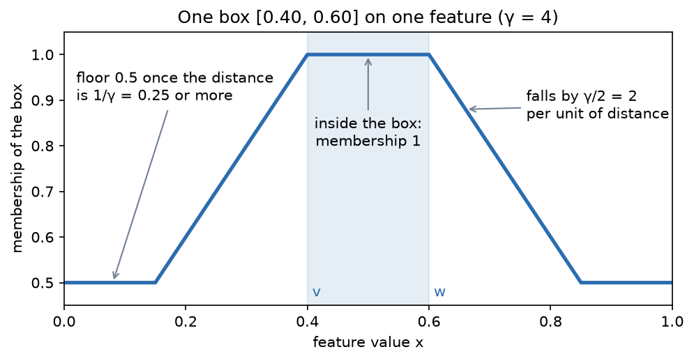
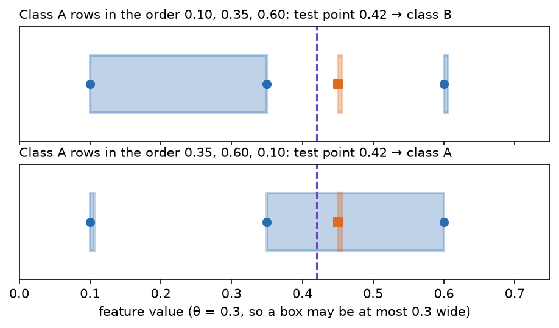
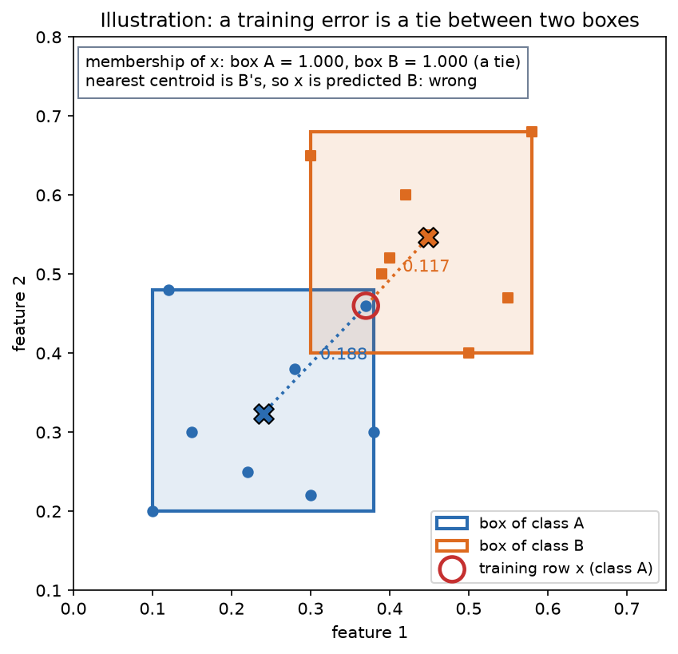
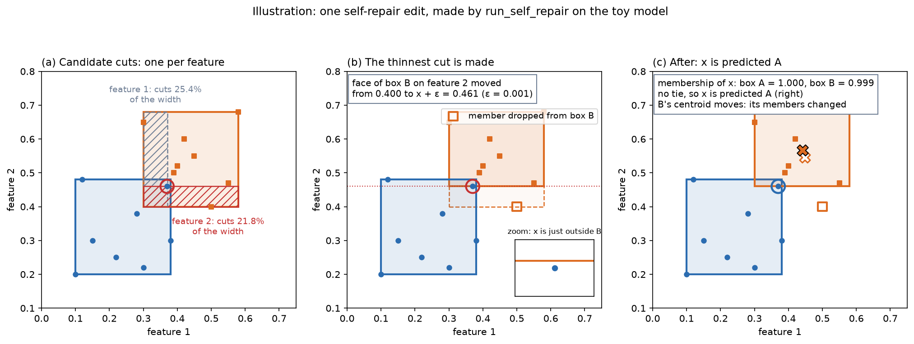
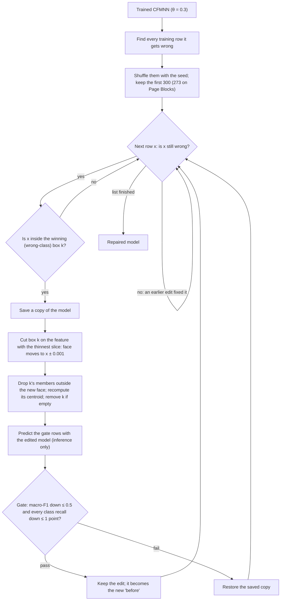
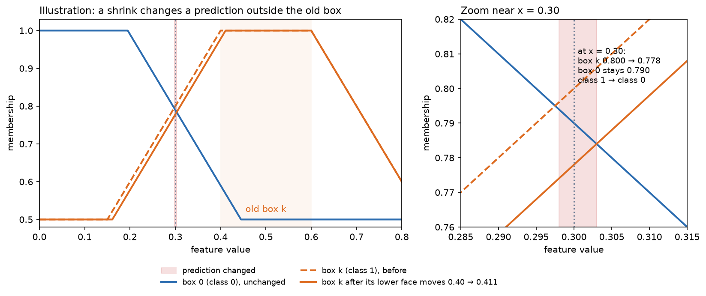
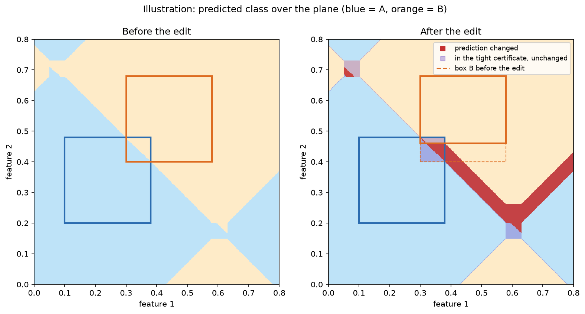
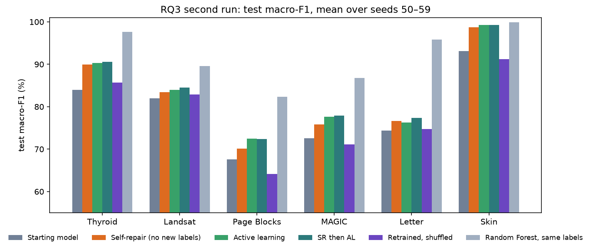
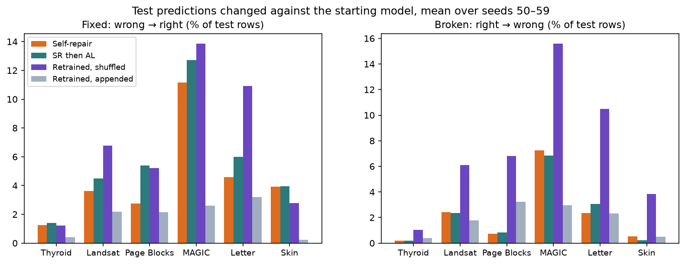

# RQ3 explained: self-repair by shrinking boxes

This page explains RQ3 from the ground up: what CFMNN's errors look like, what one repair edit does to a box, how the gate decides, how long it takes, what the results are, and what it cannot do. It is written for readers of the paper (rev 311) and for anyone checking the code.

Sources:
- **Numbers from the RQ3 run** are recomputed from the committed results in [`results/refinement_v2_confirmatory/`](../results/refinement_v2_confirmatory/) (seeds 50–59, pre-registered) by [`docs/rq3_figures.py`](rq3_figures.py). Its output is in [`docs/figures/rq3_numbers.txt`](figures/rq3_numbers.txt).
- **Timings** come from a separate check described in [section 11](#11-results), in [`results/rq3_explainer_timing/`](../results/rq3_explainer_timing/).
- **The toy figures** are illustrations. They are drawn by running our own code (`CFMNN`, `run_self_repair`, `audit.certify`) on small made-up data, and every fact stated about them is checked by an `assert` in the script.

## Contents

0. [In one paragraph](#0-in-one-paragraph)
1. [What RQ3 asks, and the answer](#1-what-rq3-asks-and-the-answer)
2. [How CFMNN predicts and trains](#2-how-cfmnn-predicts-and-trains)
3. [Why every training error is a tie](#3-why-every-training-error-is-a-tie)
4. [Why retraining does not fix these errors](#4-why-retraining-does-not-fix-these-errors)
5. [How one edit works](#5-how-one-edit-works)
6. [The gate](#6-the-gate)
7. [When: the repair loop](#7-when-the-repair-loop)
8. [Where: a map of the code](#8-where-a-map-of-the-code)
9. [What changes and what stays the same](#9-what-changes-and-what-stays-the-same)
10. [Certificates: the link to RQ4](#10-certificates-the-link-to-rq4)
11. [Results](#11-results)
12. [Why not something else](#12-why-not-something-else)
13. [Limits and failure modes](#13-limits-and-failure-modes)
14. [Common misreadings](#14-common-misreadings)
15. [How to reproduce](#15-how-to-reproduce)

## 0. In one paragraph

CFMNN classifies with boxes, and every box belongs to one class. When CFMNN gets a training row wrong, the row always sits inside a box of its own class and inside a box of a wrong class. Both boxes give it the highest possible membership, 1, so they tie. The tie is broken by the nearest box centre (centroid), and that rule picks the wrong box. Self-repair fixes such an error by moving one face of the wrong box just past the row, so the row falls outside it. Each edit is then checked on the training rows by a gate, and undone if it makes macro-F1 or any class's recall noticeably worse. It needs no new labels, no epochs and no retraining. Only one box changes per edit, and the model is only re-run for prediction to check the edit.

### Glossary

| Term | Meaning here |
|---|---|
| Box (hyperbox) | A rectangle in feature space, from a lower corner $v$ to an upper corner $w$, with one class. In $d$ features it has $2d$ faces. |
| Face | One side of a box: the lower bound $v_i$ or the upper bound $w_i$ on one feature $i$. |
| Membership | A number in [0.5, 1] for each box at an input $x$. It is 1 inside the box and falls off outside it. |
| Centroid | The mean of the training rows that belong to a box (its members). |
| Tie | Two or more boxes share the highest membership at $x$, within $10^{-9}$. |
| Edit (shrink) | Moving one face of one box, in one feature, just past a point. |
| Gate | The check each edit must pass, or be undone. |
| Rollback | Restoring the saved copy of the model from before a failed edit. |
| Certificate | A set of inputs, computed from the model before and after an edit, that contains every prediction the edit changed (RQ4). |
| Fixed / broken | A test prediction that went from wrong to right / from right to wrong, against the starting model. |
| Fix share | fixed ÷ (fixed + broken). |
| SR | Self-repair: edits on the model's own training errors, gated on the training rows. No new labels. |
| AL | Active learning: buys labels for pool points chosen by a trust signal, adds them, and shrinks when they lie inside a wrong-class box. It is gated on separate labelled acceptance rows. |
| SR then AL | SR first, then AL on the repaired model. |

## 1. What RQ3 asks, and the answer

The paper's RQ3 is:

> With every label counted, does buying new labels improve CFMNN beyond repairing its own training errors?

RQ3 compares three ways to improve a trained CFMNN. All three use the same edit and gate, and each tries the same number of points: 300, or 273 on Page Blocks, whose pool is smaller.

| Method | Points it tries to fix | Rows the gate reads | Labels beyond the training rows |
|---|---|---|---|
| Self-repair (SR) | The model's own training errors, in a fixed random order | Training rows | None |
| Active learning (AL) | Pool points chosen by the order ensemble, in 10 rounds | Separate acceptance rows | 821–24,806: the bought labels plus the acceptance rows |
| SR then AL | SR, then AL on the repaired model | Training rows, then acceptance rows | Same as AL |

**The answer**, from the paper's pre-registered second run (6 datasets, seeds 50–59; each comparison is a paired Wilcoxon test over seeds with Holm correction):

- **Self-repair helps on every dataset, with no new labels.** It gains 1.5–6.0 macro-F1 points over the starting model, significant on all 6.
- **Bought labels add something on only 3 of the 6.** SR then AL beat SR alone on Landsat (+1.1), MAGIC (+2.0) and Letter (+0.7). On Thyroid, Page Blocks and Skin the difference was not significant.
- **Self-repair was shown to be no worse than AL (within 1 point) only on Letter.** It trailed AL by 2.3 points on Page Blocks and 1.8 on MAGIC.
- **The gap to other models remains.** A Random Forest given the same labels stays 5–19 points ahead on 5 of the 6 datasets.

The rest of this page explains why self-repair works at all, and what exactly it does.

## 2. How CFMNN predicts and trains

All features are scaled to [0, 1]. The CFMNN here is the one of Aadarsh and Sai Prasad (PReMI 2023), with our two fixes from the paper's Section 3: the centroid is the true mean of a box's members ("fixed"), and a row may grow any same-class box that stays within the size limit ("search"). We use θ = 0.3 and γ = 4.

### Membership

For one feature, Simpson's ramp is

$$f(t) = \max\big(0,\; 1 - \max(0,\; \gamma \min(1, t))\big).$$

The term of box $j$ on feature $i$ at input $x$ is

$$m_{ji}(x) = \tfrac12\Big[f(x_i - w_{ji}) + f(v_{ji} - x_i)\Big],$$

and the membership of box $j$ is the mean over the $d$ features:

$$b_j(x) = \frac{1}{d}\sum_{i=1}^{d} m_{ji}(x).$$

Each term is 1 when $v_{ji} \le x_i \le w_{ji}$. Outside, it falls by $\gamma/2 = 2$ per unit of distance, down to a floor of 0.5. A point can be outside a box on only one side of each feature, so one of the two ramps is always 1. So $b_j(x) = 1$ exactly when $x$ is inside box $j$.



*Figure 1. The membership of the box [0.40, 0.60] on one feature, from `feature_terms` in our code.*

### Prediction

1. Find the highest membership, $b^* = \max_j b_j(x)$.
2. The tied set is $T(x) = \{\, j : b_j(x) \ge b^* - 10^{-9} \,\}$.
3. The winning box is the one in $T(x)$ whose centroid $c_j$ is nearest: $j^* = \arg\min_{j \in T(x)} \lVert x - c_j \rVert^2$.
4. The prediction is the class of $j^*$.

### Training

CFMNN reads the training rows once, in order, and never goes back. There are no epochs. For each row:

- **No box of its class yet:** the row starts a new box of zero size.
- **Already inside a box of its class:** it joins that box. The box's count and sum grow, and its centroid moves.
- **Otherwise:** it grows the highest-membership box of its class that can take it without breaking the size limit

$$\sum_{i=1}^{d} (w_{ji} - v_{ji}) \le d\,\theta.$$

  If no box can take it, it starts a new box.

Boxes are only ever grown or added during training. Nothing is ever shrunk. Simpson's original network had a contraction step that removed overlaps between classes after each expansion; CFMNN has none.

### Order matters

Because training is a single pass, which row comes first decides where boxes start, and that decides which boxes overlap. The same rows in another order can give different boxes and different predictions.



*Figure 2. Three class-A rows and one class-B row, trained by our CFMNN in two orders (θ = 0.3). In the first order the box [0.10, 0.35] forms and 0.60 is left alone; in the second, [0.35, 0.60] forms and 0.10 is left alone. The test point at 0.42 changes class.*

## 3. Why every training error is a tie

**Claim.** Every training row that CFMNN gets wrong lies inside a box of its own class and inside a box of a wrong class, both with membership 1, and the nearest-centroid rule picks the wrong one.

**Why it must be so:**

1. During training, each row joins a box of its own class or starts one. Boxes only grow afterwards, so the row stays inside that box. Its own class therefore always reaches membership 1, the highest possible value.
2. So the top membership at that row is 1. For a wrong class to win, one of its boxes must also reach 1, which means it contains the row.
3. Both boxes are then in the tied set, and the nearest-centroid rule chose the wrong one.

**Evidence.** The paper checked this directly:
- for 100% of the training errors on all 6 RQ3 datasets, at seeds 0 and 10 ([`research_audit/scripts/check_tie_errors.py`](../research_audit/scripts/check_tie_errors.py));
- for all 347,339 training errors on all 13 datasets, at two values of θ, over 20 seeds, in the later θ-by-validation study ([`results/repair_theta/summary.md`](../results/repair_theta/summary.md)).

**What this means.** A training error is not a gap the model failed to cover. It is an overlap between two classes that the tie-break resolved the wrong way. That overlap can be removed by moving one face of the wrong box, and the row's own label tells us which box is wrong. No new label is needed.



*Figure 3. A toy model fitted by our CFMNN on 16 rows. The circled row x is class A. It is inside the A box and the B box (membership 1.000 in both), and B's centroid is nearer (0.117 against 0.188), so CFMNN predicts B. It is the only training error.*

This holds for training rows only. A test point that CFMNN gets wrong may be a tie inside an overlap, or it may lie outside every box, where a wrong box's ramp is simply highest. Self-repair works on training errors, which are always the first kind. An edit acts only on a point inside the winning box (section 5).

## 4. Why retraining does not fix these errors

There are three ways to retrain CFMNN on the training rows:

- **Same rows, same order.** Training is deterministic, so this rebuilds exactly the same boxes and the same ties. Nothing changes.
- **Same rows, shuffled order.** This builds different boxes (Figure 2), so the overlaps fall in different places. Some old errors disappear and new ones appear elsewhere. Nothing aims at the errors.
- **New rows appended after the old ones.** The first part of the pass repeats the old training exactly, so this equals the old model plus `add_points` on the new rows. This is tested: `fit(X[:m])` followed by `add_points(X[m:])` gives exactly the boxes of `fit(X)` ([`tests/test_refine.py:60`](../tests/test_refine.py), [`pace_cfmnn/cfmnn_core.py:239`](../pace_cfmnn/cfmnn_core.py)). The old boxes are kept and can only grow. An old tie is fixed only by chance, when absorbed rows move a centroid. New rows also need new labels.

The RQ3 run measured both kinds of retraining. Each used every label SR then AL used: the training rows, the 300 bought labels and the acceptance rows.

- **Shuffled retraining** changed 2.4–30.0% of test predictions. Of the changed predictions that went between right and wrong, only 41–52% were fixes, about a coin flip. It broke 1.0–15.6% of the test rows the starting model got right. Its macro-F1 moved by −3.4 to +1.8 points, never significantly (post hoc).
- **Appended retraining** changed 0.7–8.0% of test predictions, broke 0.4–3.2% of test rows, and moved macro-F1 by −2.6 to +0.9 points. That was significant only on Letter (+0.85, post hoc).

Self-repair goes the other way. It goes to each tied error and removes that overlap.

## 5. How one edit works

Take a training row $x$ with true class $t$ that the model gets wrong, and let $k$ be the winning box. By section 3, box $k$ is of a wrong class and contains $x$.

**Step 1: check that the edit applies** (`shrink_target`, [`refine.py:51`](../pace_cfmnn/refine.py)). The winner must be of a wrong class and contain $x$. If not, the row is skipped.

**Step 2: for each feature $i$, find the cut** (`face_cut`, [`refine.py:60`](../pace_cfmnn/refine.py)). Move the face of box $k$ nearer to $x_i$ to just past $x_i$, with $\varepsilon = 0.001$:

$$\text{if } x_i - v_{ki} \le w_{ki} - x_i:\quad v'_{ki} = x_i + \varepsilon,\qquad \text{share}_i = \frac{x_i + \varepsilon - v_{ki}}{w_{ki} - v_{ki}},$$

$$\text{else}:\quad w'_{ki} = x_i - \varepsilon,\qquad \text{share}_i = \frac{w_{ki} - x_i + \varepsilon}{w_{ki} - v_{ki}}.$$

The share is the part of the box's width on feature $i$ that the cut removes. It is capped at 1, and it is 1 when the box has zero width on that feature.

**Step 3: choose the feature** (`feature_volume`, [`refine.py:120`](../pace_cfmnn/refine.py)):

$$i^* = \arg\min_i \text{share}_i,$$

the thinnest slice, with the lowest index on ties. This is the "volume" rule, called C′-volume in the pre-registrations.

**Step 4: make the cut** (`shrink_box`, [`refine.py:77`](../pace_cfmnn/refine.py)):

- Only the one face moves. The box's other faces stay where they were, even if no member now sits on them.
- Box $k$ keeps only the members still inside it, i.e. those with $X_{r i^*} \ge v'_{ki^*}$ (or $\le w'_{ki^*}$).
- Its sum, count and centroid are recomputed from those members.
- If no member is left, the box is removed.
- The members cut away now belong to **no box**. They stay in the training data and are still predicted from the boxes around them.

**What happens at $x$.** On feature $i^*$, $x$ is now $\varepsilon$ outside box $k$, and on every other feature it is still inside. So

$$b_k(x) = \frac{(d-1) + \tfrac12\big[1 + (1 - \gamma\varepsilon)\big]}{d} = 1 - \frac{\gamma\varepsilon}{2d} = 1 - \frac{0.002}{d}.$$

That is below 1 by more than the tie tolerance, so box $k$ drops out of the tied set. If $x$'s own-class box is now the only box at 1, $x$ is predicted right. If another wrong-class box also contains $x$, $x$ stays wrong. Self-repair does not try that row again.

In the RQ3 run, 44.6–79.8% of accepted edits fixed their own row (section 11). The rest left it wrong, but passed the gate because they changed other predictions for the better or not at all.



*Figure 4. One edit, made by `run_self_repair` on the toy model of Figure 3. (a) Cutting box B past x on feature 1 would remove 25.4% of its width; on feature 2, 21.8%. (b) Feature 2 is chosen: the lower face moves from 0.400 to 0.461 = 0.460 + ε. The zoom shows x just outside the new face. One B member, at (0.50, 0.40), is cut away and now belongs to no box. (c) x now has membership 1.000 in A and 0.999 = 1 − 0.002/2 in B, so it is predicted A. B's centroid moves up because its members changed. The gate accepted the edit, and every training row is now right.*

The toy's cut is large on purpose, so it can be seen. In the RQ3 run, an accepted cut removed on average 0.1–10.7% of the box's width on the cut feature, depending on the dataset (section 11).

## 6. The gate

Every edit is checked by `Gate.check` ([`refine.py:183`](../pace_cfmnn/refine.py)) on a fixed set of labelled rows, the *gate rows*. Let "before" be the model after the last accepted edit and "after" the model with the new edit. All values are in percentage points. The edit is accepted only if all three hold:

$$\text{boxes(after)} \le \lfloor 1.1 \times \text{boxes at the start} \rfloor,$$

$$\text{macroF1}_{\text{before}} - \text{macroF1}_{\text{after}} \le 0.5,$$

$$\text{recall}_{c,\text{before}} - \text{recall}_{c,\text{after}} \le 1.0 \quad \text{for every class } c.$$

**Which rows the gate reads:**
- **SR** reads the training rows themselves (`run_refinement_v2.py:139`). Their labels are already known, so SR uses no label beyond the training data. These are not held-out validation rows.
- **AL** reads separate labelled acceptance rows, 10% of the data, and the paper counts those labels.

**Rollback.** Before each edit the loop saves a full copy of the model (`copy.deepcopy`, [`active.py:324`](../pace_cfmnn/active.py)). If the gate fails, that copy is restored ([`active.py:337`](../pace_cfmnn/active.py)). There is no `rollback()` method.

**The comparison is per edit, not cumulative.** "Before" is updated after each accepted edit ([`active.py:333`](../pace_cfmnn/active.py)). So each edit may lose up to 0.5 macro-F1 points and up to 1 point of a class's recall against the previous one, and small losses can add up. This is how self-repair lowered MAGIC's lowest class recall by 2.7 points on the test rows even though every single edit passed (section 13).

**The box cap never binds for SR.** SR only shrinks or removes boxes, so the box count can only fall. The cap matters for AL, which can add boxes.

## 7. When: the repair loop



In pseudocode (`run_self_repair`, [`active.py:263`](../pace_cfmnn/active.py)):

```text
errors  = training rows the model gets wrong                       # active.py:295
order   = seeded random permutation of errors, first `budget`      # active.py:296
before  = gate metrics of the model
for each row p in order (split into 10 rounds, used only for logging and checks):
    if model now predicts p right:            skip ("already right")
    k = winning box at p
    if k does not contain p:                  skip ("not inside the winning box")
    snapshot = deepcopy(model)
    i = feature with the smallest share of width cut
    shrink box k past p on feature i
    ok, after = gate.check(before, model)     # one prediction pass over the gate rows
    if ok:  before = after
    else:   model = snapshot
    (after each round: validate_structure checks the model's invariants)
```

What this means for the reviewer's questions:

- **Epochs:** none. Each listed error is visited once.
- **Retraining:** none. The boxes stay as trained, apart from the one face each accepted edit moves.
- **Model calls:** each tried edit costs one prediction pass over the gate rows. That pass is almost all of the time (section 11).
- **Order of errors:** a seeded random order. It is not ranked by any score.
- **Trust signals:** these are not used in SR. In AL, the order ensemble (RQ2's detector) scores the unlabelled pool and the top points are bought (`top_b`, [`active.py:139`](../pace_cfmnn/active.py)).

**Why "already right" is common.** One edit often fixes several errors at once: rows near the same overlap, or rows whose tie-break flips when a centroid moves. Later in the list those rows are skipped. On Skin, 261 of the 300 errors taken per seed were already right by their turn.

**Why "not inside the winning box" happens at all.** At the start every error is inside its winning box (section 3). But a cut can drop a row out of its own box. If that row is later in the list and still wrong, the winning box may no longer contain it. This is rare: 0–3.1 rows per seed.

## 8. Where: a map of the code

| What | Where |
|---|---|
| Ramp $f$ and per-feature terms $m_{ji}$ | `ramp`, `feature_terms`, [`pace_cfmnn/cfmnn_core.py:38`](../pace_cfmnn/cfmnn_core.py) |
| Training (one pass, grow or add) | `CFMNN.fit`, [`cfmnn_core.py:147`](../pace_cfmnn/cfmnn_core.py) |
| Continuing training on new rows | `CFMNN.add_points`, [`cfmnn_core.py:236`](../pace_cfmnn/cfmnn_core.py) |
| Removing a box | `CFMNN._remove_box`, [`cfmnn_core.py:308`](../pace_cfmnn/cfmnn_core.py) |
| Prediction, tied set and winner | `CFMNN.predict_details`, [`cfmnn_core.py:348`](../pace_cfmnn/cfmnn_core.py) |
| ε = 0.001 | `MARGIN`, [`pace_cfmnn/refine.py:38`](../pace_cfmnn/refine.py) |
| Which box to cut | `shrink_target`, [`refine.py:51`](../pace_cfmnn/refine.py) |
| Which face, new value, share of width | `face_cut`, [`refine.py:60`](../pace_cfmnn/refine.py) |
| The cut itself | `shrink_box`, [`refine.py:77`](../pace_cfmnn/refine.py) |
| Thinnest-slice rule | `feature_volume`, [`refine.py:120`](../pace_cfmnn/refine.py) |
| Other cut rules tried | `CHOOSERS`, [`refine.py:159`](../pace_cfmnn/refine.py) |
| The gate | `Gate`, [`refine.py:164`](../pace_cfmnn/refine.py) |
| Invariant checks | `validate_structure`, [`refine.py:196`](../pace_cfmnn/refine.py) |
| Self-repair loop | `run_self_repair`, [`pace_cfmnn/active.py:263`](../pace_cfmnn/active.py) |
| Active learning loop | `run_refinement`, [`active.py:167`](../pace_cfmnn/active.py) |
| Certificates | `certify`, [`pace_cfmnn/audit.py:77`](../pace_cfmnn/audit.py) |
| Fixed / broken counts | `prediction_churn`, [`audit.py:95`](../pace_cfmnn/audit.py) |
| The RQ3 run | [`scripts/run_refinement_v2.py`](../scripts/run_refinement_v2.py); the SR call is at lines 136–142 |
| Its rules and results | [`results/refinement_v2_confirmatory/`](../results/refinement_v2_confirmatory/): `PREREGISTRATION.md`, `summary.md`, `runs.csv`, `edits.csv.gz` |
| Tests | [`tests/test_refine.py`](../tests/test_refine.py) (e.g. `test_fixes_a_planted_training_tie_without_new_labels`, `test_failed_gate_is_rolled_back`), [`tests/test_audit.py`](../tests/test_audit.py) (`test_every_prediction_change_is_inside_the_impact_set`) |

## 9. What changes and what stays the same

**What one accepted edit changes:**
- One face of one box, on one feature: $v_{ki^*}$ or $w_{ki^*}$.
- That box's members: those beyond the new face are cut away and then belong to no box.
- That box's count, sum and centroid, recomputed from the remaining members.
- The box itself, if no member is left (it is removed and later boxes move up one index).

**What it leaves alone:**
- Every other box: its bounds, members and centroid.
- θ, γ, the membership formula and the prediction rule.
- The number of boxes, unless the edited box is removed. SR never adds a box.
- The training data: no row is added or deleted.
- Each box is still an AND rule, "if $v \le x \le w$ then class $c$", with one tighter threshold.

**What can still change outside the edited box.** It is tempting to say that only inputs inside the old box can change prediction. That is false, for two reasons:

1. **The ramp.** Membership falls gradually outside a box, so moving a face lowers the box's membership at nearby points outside it too. At such a point another class's box may now be higher.
2. **The centroid.** The edited box's centroid moves. Wherever that box is tied at the top, the nearest-centroid tie-break can now go the other way.



*Figure 5. One feature, two boxes, fitted by our CFMNN: box 0 (class 0) is [0, 0.195] and box k (class 1) is [0.40, 0.60]. Moving k's lower face to 0.411 lowers its membership at x = 0.30 from 0.800 to 0.778, below box 0's 0.790. The prediction there changes from class 1 to class 0, though 0.30 was never inside box k. Every input between 0.298 and 0.303 changed.*



*Figure 6. The toy edit of Figure 4 over a 321 × 321 grid. 4.49% of the grid changed class (red), and 86% of those points lie outside the old box B: in empty space, both memberships are below 1, and the class boundary there is where the two ramps cross. Every changed point lies inside the tight certificate (purple and red together, 6.2% of the grid).*

This is why the certificate in the next section is built from the tied sets of all boxes, not from the old box alone.

## 10. Certificates: the link to RQ4

RQ4 asks whether we can find, for each edit, a set of inputs that contains every prediction the edit changes.

**The argument** (paper Section 6; `certify`, [`audit.py:77`](../pace_cfmnn/audit.py)):
- An edit changes one box, or removes it.
- At an input $x$ where no changed box is in the tied set $T(x)$, before or after the edit, nothing that decides the prediction has changed: the top membership, the tied boxes and their centroids are all the same. So the prediction is the same.
- The **certificate** is therefore the set of inputs where a changed box is in $T(x)$ before or after.
- The **tight certificate** also drops the inputs whose tied sets, before and after, hold boxes of only one class. Those are predicted that class both times.

Both are computed from the two models alone, without labels.

**Results** (paper Section 7, for SR then AL unless named):
- **No misses.** No prediction changed outside its certificate: 0 in 46,153 accepted edits, for both certificates. The argument guarantees this; the count checks the code.
- **Loose.** A tight certificate held 1.2–35% of the test rows per edit, and only 0.2–3.7% of those rows changed. For SR alone the share that changed was 2.1–10.4%. So the certificate is a safe bound, not an "if and only if".
- **Explanations not covered.** Among explained rows outside every edit's tight certificate, PACE-flip's top-3 features still changed on up to 51% (MAGIC). PACE-flip looks at boxes that could win after a feature changes, not only at the boxes that are best now.

## 11. Results

All values are means over seeds 50–59 from the committed `runs.csv`, recomputed by `docs/rq3_figures.py`. SR and SR then AL are kept apart throughout. The paper's RQ4 table reports SR then AL; SR's own values are given here.

### Accuracy



*Figure 7. Test macro-F1 per dataset.*

| Test macro-F1 (%) | Thyroid | Landsat | Page Blocks | MAGIC | Letter | Skin |
|---|---|---|---|---|---|---|
| Starting model | 83.96 | 81.98 | 67.56 | 72.59 | 74.34 | 93.10 |
| **Self-repair (no new labels)** | **89.98** | **83.46** | **70.14** | **75.86** | **76.59** | **98.76** |
| Active learning | 90.33 | 83.93 | 72.44 | 77.66 | 76.27 | 99.23 |
| SR then AL | 90.55 | 84.54 | 72.42 | 77.89 | 77.33 | 99.31 |
| Retrained, shuffled | 85.73 | 82.86 | 64.18 | 71.10 | 74.70 | 91.18 |
| Retrained, appended | 84.35 | 82.26 | 64.96 | 72.33 | 75.19 | 92.62 |
| Random Forest, same labels | 97.67 | 89.56 | 82.37 | 86.77 | 95.86 | 99.93 |

| Lowest class recall (%) | Thyroid | Landsat | Page Blocks | MAGIC | Letter | Skin |
|---|---|---|---|---|---|---|
| Starting model | 59.19 | 47.29 | 52.42 | 71.86 | 49.65 | 80.92 |
| Self-repair | 78.56 | 53.70 | 52.50 | 69.13 | 52.58 | 97.57 |
| SR then AL | 79.67 | 56.43 | 51.16 | 70.64 | 53.41 | 98.79 |

### Which predictions changed



*Figure 8. Test predictions fixed (left) and broken (right) against the starting model.*

| % of test rows | Thyroid | Landsat | Page Blocks | MAGIC | Letter | Skin |
|---|---|---|---|---|---|---|
| Broken, SR | 0.19 | 2.42 | 0.73 | 7.25 | 2.35 | 0.54 |
| Broken, SR then AL | 0.19 | 2.36 | 0.82 | 6.85 | 3.06 | 0.22 |
| Broken, retrained shuffled | 1.03 | 6.09 | 6.81 | 15.60 | 10.48 | 3.83 |
| Broken, retrained appended | 0.39 | 1.77 | 3.23 | 2.97 | 2.33 | 0.49 |
| Fix share, SR | 86.44 | 58.96 | 69.36 | 60.35 | 65.93 | 87.50 |
| Fix share, SR then AL | 85.29 | 64.22 | 81.94 | 64.80 | 66.23 | 94.14 |
| Fix share, retrained shuffled | 51.83 | 52.36 | 42.56 | 47.19 | 50.92 | 40.54 |
| Fix share, retrained appended | 51.17 | 54.96 | 31.96 | 46.42 | 57.75 | 44.38 |

The honest reading:

- **Against shuffled retraining**, repair is better on every count. The fix share of SR then AL was higher on all 6 datasets, by 12–54 points (the main RQ4 test). It broke fewer predictions and was 1.7–8.2 points more accurate.
- **Against appended retraining**, repair still has the higher fix share on all 6 and is 2.1–7.5 points more accurate. But SR then AL broke more predictions on Landsat, MAGIC and Letter.
- Appended retraining changes few predictions because it keeps the old boxes (section 4). It also fixes few, and needs new labels.

### What the edits did (SR, mean per seed)

| | Thyroid | Landsat | Page Blocks | MAGIC | Letter | Skin |
|---|---|---|---|---|---|---|
| Training rows | 3,600 | 3,217 | 2,736 | 9,510 | 10,000 | 122,528 |
| Boxes at the start | 45.5 | 146.4 | 22.0 | 232.0 | 461.1 | 82.1 |
| Training error at the start → end (%) | 1.66 → 0.40 | 9.36 → 5.98 | 10.37 → 8.43 | 24.55 → 19.69 | 20.23 → 16.65 | 4.19 → 0.76 |
| Errors taken from the list | 59.6 | 288.3 | 234.8 | 300.0 | 300.0 | 300.0 |
| Skipped: already right | 38.7 | 101.7 | 51.6 | 100.0 | 41.6 | 261.1 |
| Skipped: not inside the winning box | 0.0 | 3.1 | 2.1 | 1.3 | 0.3 | 0.8 |
| Shrinks tried | 20.9 | 183.5 | 181.1 | 198.7 | 258.1 | 38.1 |
| Accepted | 12.9 | 166.3 | 12.5 | 196.2 | 201.8 | 33.6 |
| Rejected: macro-F1 | 4.6 | 1.1 | 55.1 | 1.4 | 0.4 | 4.1 |
| Rejected: a class's recall | 3.4 | 16.1 | 113.5 | 1.1 | 55.9 | 0.4 |
| Accepted edits that fixed their own row (%) | 79.8 | 51.5 | 67.2 | 57.5 | 44.6 | 78.6 |
| Members cut away per accepted edit: median (mean) | 12 (135.3) | 2 (4.2) | 2 (12.7) | 3 (15.6) | 3 (5.1) | 10 (72.6) |
| Share of width cut per accepted edit (%) | 0.1 | 5.5 | 2.3 | 7.4 | 0.5 | 10.7 |

Thyroid had fewer training errors than the budget, so all of them were taken. Over all 60 SR runs, 8,804 shrinks were tried and 6,233 accepted.

### Time

**Self-repair is slower than retraining.** In the committed RQ3 run, SR took 3.3–1,029.7 seconds per run (mean over seeds), and shuffled retraining 0.21–10.84 seconds. But those SR times also include the certificate audit, which runs on 2,000 test rows after every accepted edit, and they were measured with 4 runs sharing 4 cores.

**SR's own cost.** To measure that, [`docs/rq3_timing.py`](rq3_timing.py) reran SR exactly as RQ3 calls it, without the audit, one dataset at a time, on seed 50. Its test macro-F1 matched the committed run on all 6 datasets. This is a descriptive check made after the study, not part of any pre-registered run. Results are in [`results/rq3_explainer_timing/summary.md`](../results/rq3_explainer_timing/summary.md).

| Seed 50 | Training rows | Features | Boxes | Shrinks tried | Fit (s) | One prediction pass over the training rows (s) | SR (s) | Gate's share of SR | Committed SR time, with audit (s) |
|---|---|---|---|---|---|---|---|---|---|
| Thyroid | 3,600 | 21 | 42 | 23 | 0.15 | 0.05 | 1.5 | 92% | 4.2 |
| Page Blocks | 2,736 | 10 | 22 | 179 | 0.08 | 0.02 | 4.1 | 96% | 8.2 |
| Landsat | 3,217 | 36 | 143 | 198 | 0.17 | 0.24 | 60.5 | 99% | 154.7 |
| Skin | 122,528 | 3 | 85 | 19 | 5.73 | 1.18 | 34.6 | 95% | 52.0 |
| MAGIC | 9,510 | 10 | 241 | 208 | 0.46 | 0.48 | 138.4 | 99% | 226.7 |
| Letter | 10,000 | 16 | 451 | 258 | 0.43 | 1.90 | 535.2 | 99% | 910.3 |

Measured on the paper's laptop (Intel i7-8650U, 4 cores, Windows 11, Python 3.14). The unit tests ran alongside for about the last 2 minutes of Letter, so its time may be a little high.

**Where the time goes.** The gate takes 92–99% of SR's time. Each tried shrink needs one prediction pass over all $N$ training rows, and a pass compares every row with all $H$ boxes on all $d$ features: about $N \cdot H \cdot d$ steps. So, roughly,

$$\text{SR time} \approx (\text{shrinks tried} + 1) \times \text{one prediction pass}.$$

On Letter that is 259 passes of 1.9 seconds, about 490 of its 535 seconds. Training is much cheaper: it passes over the rows once and compares each row only with the boxes of its own class. That is why SR took 6 to 1,234 times as long as a fit.

**What this means.** Repair's case is not speed. It changes few predictions, mostly for the better, each edit is small and can be listed, and SR needs no new labels. Its cost is about 2 seconds to 9 minutes per repair on these datasets, which matters only if a model must be repaired often.

**A possible speed-up (not tested).** The certificate (section 10) contains every row whose prediction an edit can change. The gate could re-predict only those rows and update its counts, instead of re-predicting all of them, and get exactly the same decision.

## 12. Why not something else

| Alternative | Why it is not the method | Evidence |
|---|---|---|
| **Retrain CFMNN** | The same order rebuilds the same ties. A new order moves the ties around at random. Appending new rows keeps the old ties and needs new labels. | Section 4; shuffled retraining's fix share was 41–52%. |
| **Simpson's contraction during training** | CFMNN was designed without it. Contraction acts on every overlap during training, not only where the model errs, and is not gated. Self-repair is a gated contraction applied only where CFMNN errs. | Not tested fairly. A one-off contraction after training was added to the first run by amendment, but it was not a fair stand-in for Simpson's method ([`summary_v1.md`](../results/refinement_confirmatory/summary_v1.md), appendix). |
| **Cut on the feature PACE's explanation names** | The first, pre-registered run tested this as its main question. It was no better than the thinnest cut on any dataset, and worse than a random feature on Letter. Its accepted cuts removed 22–30% of the box's width on average, against 0.1–10% for the thinnest cut. | Paper Section 7, "Repair, first run" (seeds 10–19); [`summary_v1.md`](../results/refinement_confirmatory/summary_v1.md). |
| **Try every feature and keep the gate's best** | An upper bound, not a method. It gained only −0.6 to +1.1 points over the thinnest cut, so the question of which feature to cut was closed. | Exploratory checks, seeds 0–2. |
| **Buy labels (active learning)** | It reads 821–24,806 labels beyond the training rows: the bought labels plus the acceptance rows. After self-repair it added a significant gain on only 3 of 6 datasets. | Paper Section 7, RQ3. |
| **Choose a smaller θ by validation** | The model at θ chosen by validation beat self-repair at θ = 0.3 on 7 of 13 datasets (accuracy), but with 6–23 times as many boxes on 6 datasets: a much larger model to read. Self-repair adds no boxes. | [`results/repair_theta/summary.md`](../results/repair_theta/summary.md); paper Section 7. |
| **Use kNN or a Random Forest** | More accurate (the Random Forest by 5–19 points on 5 of 6), but neither is a set of readable boxes, and neither gives certificates. | Paper Section 7, RQ3 table. |

## 13. Limits and failure modes

- **Small losses add up.** The gate compares each edit with the previous model, not with the starting one. On MAGIC, self-repair lowered the lowest class recall on the test rows by 2.7 points, in 9 of 10 seeds. A gate against the starting model was not tested.
- **Some datasets accept few edits.** On Page Blocks only 12.5 of 181.1 tried shrinks per seed were accepted. Most were rejected because one class's recall would fall by more than 1 point, and Page Blocks has small classes.
- **A tiny cut can remove many members.** On features with few distinct values (binary or rounded), many members sit exactly on a face. Moving that face by ε cuts all of them away. On Thyroid the median accepted edit cut 12 members while removing only 0.1% of the width on average; one edit cut 2,119.
- **Cut-away members belong to no box.** They are still predicted from the remaining boxes, and the gate checks them like any other row. But later in the repair they may become errors that are not ties.
- **An accepted edit may not fix its own row.** Only 44.6–79.8% did. If another wrong-class box also contains the row, it stays wrong.
- **It is slower than retraining.** See [Time](#time). The cost grows with training rows × boxes × features × edits tried.
- **The certificates are loose** and do not cover changes to explanations (section 10).
- **The scope is limited.** There are 6 datasets in the RQ3 run (13 in the θ study), one budget (300) and one gate (0.5 / 1.0 points). Other budgets and gates were not tested.
- **Repair does not close the gap to stronger models.** The Random Forest stays 5–19 points ahead on 5 of 6 datasets.

## 14. Common misreadings

| Claim | Correct version | Source |
|---|---|---|
| "How many epochs does repair run?" | None. Each listed training error is visited once, and an edit is one face move followed by one prediction pass. | `active.py:311–337` |
| "Repair retrains the model after each edit." | No. Boxes are never refitted. Only the edited box's face, members and centroid change. | `refine.py:77–102` |
| "The gate uses a held-out validation set." | For SR the gate reads the training rows, so no new labels are used. AL's gate reads separate acceptance rows, and those labels are counted. | `run_refinement_v2.py:139`, paper Section 6 |
| "Errors are fixed in order of a trust score." | SR takes them in a seeded random order. Trust signals (the order ensemble) only choose which pool points AL buys. | `active.py:296`, `active.py:139` |
| "Repair is faster than retraining." | It is slower: one prediction pass per tried edit against one training pass. Its case is targeted change, not speed. | Section 11, Time |
| "Inputs outside the edited box cannot change prediction." | False. The ramp and the moved centroid can change predictions outside it (Figures 5 and 6). The certificate uses tied sets for that reason. | Section 9 |
| "An input changes if and only if it is in the certificate." | The certificate is a safe bound: nothing outside it changed, but most inputs inside it did not change (0.2–3.7% did, SR then AL). | Paper Section 7, RQ4 |
| "Self-repair broke 6.85% on MAGIC with fix share 64.8%." | Those are SR then AL. SR alone broke 7.25% with fix share 60.35%. | Section 11 |
| "SR then AL uses zero new labels." | Only SR uses none. SR then AL buys 300 labels and reads the acceptance rows. | Paper Section 6 table |
| "Certificates can be checked in O(d)." | Finding the tied set at an input means comparing all H boxes, so it costs O(H·d) per input. | `audit.py:47–67` |

## 15. How to reproduce

From the repository root, with the data in `data/` as described in the README:

```bash
python -B docs/rq3_figures.py
```

Redraws every figure here and rewrites `docs/figures/rq3_numbers.txt`. It takes about a minute, reads `results/` only, and stops if any toy fact stated on this page is false.

```bash
python -B docs/rq3_timing.py
```

The timing check: about 20 minutes on a 4-core laptop. It writes `results/rq3_explainer_timing/`.

```bash
python scripts/run_refinement_v2.py --jobs 4
```

The full pre-registered RQ3 run, seeds 50–59: about 3 hours with 4 workers. It overwrites `results/refinement_v2_confirmatory/`, so run it on a copy.
