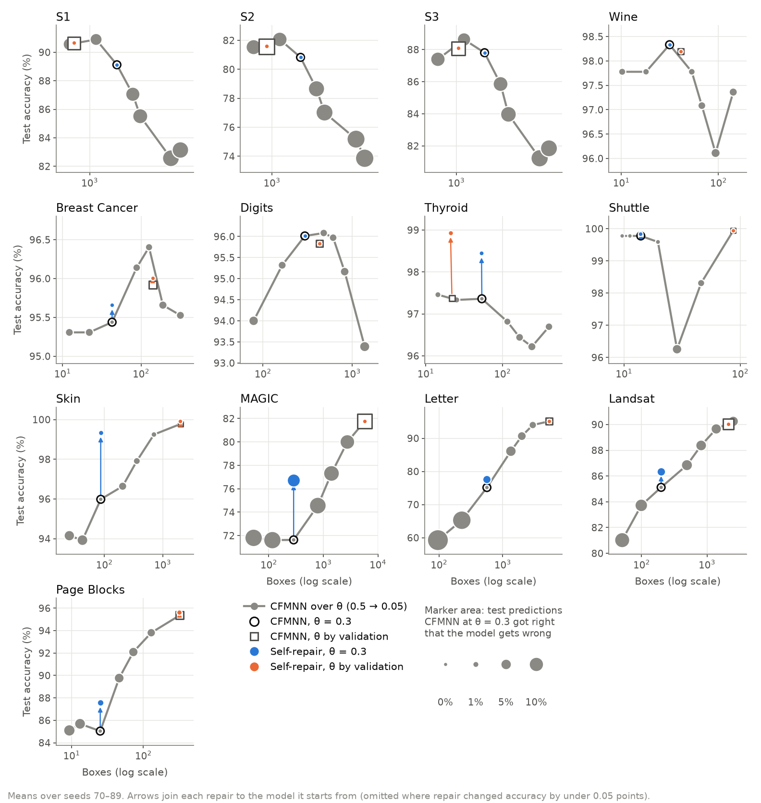

# Tough review: re-analysis of committed results

Written by `scripts/tough_review_reanalysis.py` from committed `runs.csv` files; nothing was refitted. Post hoc: none of this was pre-registered. The rules (the test, the ratios, the families, the margins) are in the script's docstring, fixed before any number was computed.

## 1. Every primary comparison, corrected (D1)

56 primary comparisons from 20 runs, 511 dataset-level verdicts. The paper's verdicts (Wilcoxon, Holm across datasets) call 306 of them significant. With the Nadeau–Bengio correction and Holm across each run's primaries, **154 verdicts change: 154 significant results become not significant, 0 go the other way, and 0 change direction.**

Columns give better / not significant / worse for the first method:

- **Paper:** two-sided Wilcoxon over seeds, Holm across datasets;
- **+ run Holm:** the same test, Holm across every primary comparison and dataset of the run;
- **NB:** the Nadeau–Bengio corrected t-test, Holm across datasets;
- **NB + run Holm:** both corrections. "Survives" counts the paper's significant verdicts that keep their direction here.
- **Across units:** a signed-rank test of the per-dataset mean differences (D2).

Two things drive the changes. First, the Wilcoxon test over 10 seeds cannot give p below 0.00195, so Holm across k tests can reject only when 0.00195 × k < 0.05, that is k ≤ 25; in a run with more dataset-level tests, "+ run Holm" loses every verdict whatever the data (with 20 seeds the floor is 1.9e-6 and this does not bite). The t-test has no such floor. Second, the Nadeau–Bengio factor (1/J + n2/n1) against 1/J multiplies the variance by 3.5 for 10 seeds on the 80/20 split, by 6 for 20 seeds, and by 7–9 for the trust-signal runs, which score 40% of the rows. Several plans said their primaries answer separate questions and are not corrected for each other; the run-level columns are the review's stricter reading, not the plans'.

| Run (seeds) | Comparison | Units | Paper | + run Holm | NB | NB + run Holm | Survives | Across units p |
|---|---|---|---|---|---|---|---|---|
| Trust signals, confirmatory (10–19) | AUPRC, PD + U* vs the plain margin | 8 | 6 / 2 / 0 | 6 / 2 / 0 | 5 / 3 / 0 | 5 / 3 / 0 | 5 of 6 | 0.039 |
| Trust signals, confirmatory (10–19) | AUPRC, PRS* vs PD + U* | 8 | 0 / 2 / 6 | 0 / 2 / 6 | 0 / 4 / 4 | 0 / 4 / 4 | 4 of 6 | 0.008 |
| First repair run (10–19) | macro-F1, cut by the contrastive explanation vs by width | 6 | 0 / 6 / 0 | 0 / 6 / 0 | 0 / 6 / 0 | 0 / 6 / 0 | 0 of 0 | 0.562 |
| Trust signals, combination (20–29) | AUPRC, LR on kNN + TS + order ensemble vs on kNN + TS | 8 | 5 / 2 / 1 | 5 / 2 / 1 | 2 / 6 / 0 | 2 / 6 / 0 | 2 of 6 | 0.109 |
| RQ1, second run (30–39) | deletion margin AUC, PACE-SHAP vs KernelSHAP | 11 | 6 / 5 / 0 | 6 / 5 / 0 | 2 / 9 / 0 | 2 / 9 / 0 | 2 of 6 | 0.005 |
| Extensions (40–49) | features changed, PACE-sparse vs DiCE | 11 | 10 / 0 / 1 | 0 / 11 / 0 | 8 / 2 / 1 | 6 / 4 / 1 | 7 of 11 | 0.042 |
| Extensions (40–49) | agreement with permutation importance, mean |PACE-SHAP| vs mean |KernelSHAP| | 11 | 0 / 11 / 0 | 0 / 11 / 0 | 0 / 11 / 0 | 0 / 11 / 0 | 0 of 0 | 0.240 |
| Extensions (40–49) | conditional deletion margin AUC, PACE-SHAP-cond vs KernelSHAP-cond | 13 | 6 / 7 / 0 | 0 / 13 / 0 | 2 / 11 / 0 | 2 / 11 / 0 | 2 of 6 | 0.000 |
| Extensions (40–49) | conditional insertion margin AUC, PACE-SHAP-cond vs KernelSHAP-cond | 13 | 6 / 7 / 0 | 0 / 13 / 0 | 1 / 12 / 0 | 1 / 12 / 0 | 1 of 6 | 0.001 |
| Extensions (40–49) | share of inputs off the data, conditional vs usual game | 13 | 13 / 0 / 0 | 0 / 13 / 0 | 13 / 0 / 0 | 13 / 0 / 0 | 13 of 13 | 0.000 |
| Stability and ties (50–59) | stability with rows kept, PACE-SHAP vs KernelSHAP | 11 | 11 / 0 / 0 | 9 / 2 / 0 | 8 / 3 / 0 | 7 / 4 / 0 | 7 of 11 | 0.001 |
| Stability and ties (50–59) | stability with new rows, PACE-SHAP vs KernelSHAP | 11 | 10 / 1 / 0 | 10 / 1 / 0 | 5 / 6 / 0 | 4 / 7 / 0 | 4 of 10 | 0.001 |
| Repair, second run (RQ2) (50–59) | macro-F1, SR + AL vs SR | 6 | 3 / 3 / 0 | 3 / 3 / 0 | 1 / 5 / 0 | 1 / 5 / 0 | 1 of 3 | 0.031 |
| Repair, second run (RQ2) (50–59) | fix share, SR + AL vs shuffled retraining | 6 | 6 / 0 / 0 | 6 / 0 / 0 | 6 / 0 / 0 | 5 / 1 / 0 | 5 of 6 | 0.031 |
| Ensembles (60–69) | AUPRC, order ensemble vs bagged ensemble, each added to kNN + TS | 8 | 0 / 8 / 0 | 0 / 8 / 0 | 0 / 8 / 0 | 0 / 8 / 0 | 0 of 0 | 0.383 |
| Readable models (70–89) | accuracy, CFMNN-val vs Tree | 13 | 5 / 0 / 8 | 5 / 0 / 8 | 4 / 1 / 8 | 3 / 4 / 6 | 9 of 13 | 1.000 |
| Readable models (70–89) | accuracy, CFMNN-val vs LogReg | 13 | 7 / 2 / 4 | 7 / 2 / 4 | 7 / 4 / 2 | 7 / 4 / 2 | 9 of 11 | 0.380 |
| Readable models (70–89) | accuracy, CFMNN-val vs EBM | 13 | 2 / 2 / 9 | 2 / 2 / 9 | 2 / 5 / 6 | 2 / 5 / 6 | 8 of 11 | 0.127 |
| Readable models (70–89) | accuracy, CFMNN-0.3 vs GFMM-0.3 (primary in the plan (P4), missing from Appendix E) | 13 | 4 / 3 / 6 | 3 / 6 / 4 | 2 / 8 / 3 | 2 / 8 / 3 | 5 of 10 | 0.735 |
| Repair at the chosen θ (70–89) | accuracy, SR-0.3 vs B0-val | 13 | 1 / 5 / 7 | 1 / 5 / 7 | 1 / 7 / 5 | 0 / 8 / 5 | 5 of 8 | 0.021 |
| Repair at the chosen θ (70–89) | accuracy, SR-val vs B0-val | 13 | 3 / 10 / 0 | 3 / 10 / 0 | 1 / 12 / 0 | 1 / 12 / 0 | 1 of 3 | 0.005 |
| Follow-up: more points (110–119) | deletion margin AUC, PACE-SHAP vs KernelSHAP | 11 | 7 / 4 / 0 | 0 / 11 / 0 | 4 / 7 / 0 | 3 / 8 / 0 | 3 of 7 | 0.002 |
| Follow-up: more points (110–119) | insertion margin AUC, PACE-SHAP vs KernelSHAP | 11 | 8 / 3 / 0 | 0 / 11 / 0 | 4 / 7 / 0 | 3 / 8 / 0 | 3 of 8 | 0.001 |
| Follow-up: more points (110–119) | deletion margin AUC, PACE-SHAP vs KernelSHAP-same | 11 | 4 / 7 / 0 | 0 / 11 / 0 | 4 / 7 / 0 | 4 / 7 / 0 | 4 of 4 | 0.001 |
| Follow-up: more points (110–119) | insertion margin AUC, PACE-SHAP vs KernelSHAP-same | 11 | 5 / 6 / 0 | 0 / 11 / 0 | 4 / 7 / 0 | 4 / 7 / 0 | 4 of 5 | 0.002 |
| Follow-up: conditional settings (110–119) | conditional deletion, PACE-SHAP-cond vs KernelSHAP-cond, sigma=0.05, rows=200 | 6 | 4 / 2 / 0 | 0 / 6 / 0 | 3 / 3 / 0 | 1 / 5 / 0 | 1 of 4 | 0.031 |
| Follow-up: conditional settings (110–119) | conditional insertion, PACE-SHAP-cond vs KernelSHAP-cond, sigma=0.05, rows=200 | 6 | 4 / 2 / 0 | 0 / 6 / 0 | 1 / 5 / 0 | 1 / 5 / 0 | 1 of 4 | 0.031 |
| Follow-up: conditional settings (110–119) | conditional deletion, PACE-SHAP-cond vs KernelSHAP-cond, sigma=0.2, rows=200 | 6 | 3 / 3 / 0 | 0 / 6 / 0 | 1 / 5 / 0 | 1 / 5 / 0 | 1 of 3 | 0.031 |
| Follow-up: conditional settings (110–119) | conditional insertion, PACE-SHAP-cond vs KernelSHAP-cond, sigma=0.2, rows=200 | 6 | 3 / 3 / 0 | 0 / 6 / 0 | 1 / 5 / 0 | 1 / 5 / 0 | 1 of 3 | 0.031 |
| Follow-up: conditional settings (110–119) | conditional deletion, PACE-SHAP-cond vs KernelSHAP-cond, sigma=0.4, rows=200 | 6 | 3 / 3 / 0 | 0 / 6 / 0 | 1 / 5 / 0 | 1 / 5 / 0 | 1 of 3 | 0.062 |
| Follow-up: conditional settings (110–119) | conditional insertion, PACE-SHAP-cond vs KernelSHAP-cond, sigma=0.4, rows=200 | 6 | 3 / 3 / 0 | 0 / 6 / 0 | 1 / 5 / 0 | 0 / 6 / 0 | 0 of 3 | 0.062 |
| Follow-up: conditional settings (110–119) | conditional deletion, PACE-SHAP-cond vs KernelSHAP-cond, sigma=0.2, rows=800 | 6 | 3 / 3 / 0 | 0 / 6 / 0 | 1 / 5 / 0 | 1 / 5 / 0 | 1 of 3 | 0.031 |
| Follow-up: conditional settings (110–119) | conditional insertion, PACE-SHAP-cond vs KernelSHAP-cond, sigma=0.2, rows=800 | 6 | 6 / 0 / 0 | 0 / 6 / 0 | 3 / 3 / 0 | 1 / 5 / 0 | 1 of 6 | 0.031 |
| Follow-up: counterfactuals (110–119) | distance moved after a nudge (r1), PACE vs DiCE random | 11 | 11 / 0 / 0 | 0 / 11 / 0 | 11 / 0 / 0 | 9 / 2 / 0 | 9 of 11 | 0.001 |
| Follow-up: counterfactuals (110–119) | validity after a refit (r3), PACE vs DiCE random | 11 | 1 / 7 / 3 | 0 / 11 / 0 | 0 / 8 / 3 | 0 / 10 / 1 | 1 of 4 | 0.198 |
| Follow-up: counterfactuals (110–119) | distance moved after a nudge (r1), PACE-sparse vs DiCE random | 11 | 11 / 0 / 0 | 0 / 11 / 0 | 10 / 1 / 0 | 8 / 3 / 0 | 8 of 11 | 0.001 |
| Follow-up: counterfactuals (110–119) | validity after a refit (r3), PACE-sparse vs DiCE random | 11 | 1 / 3 / 7 | 0 / 11 / 0 | 0 / 7 / 4 | 0 / 9 / 2 | 2 of 8 | 0.054 |
| Follow-up: budget and gate (110–119) | macro-F1, SR-b100 vs SR-default | 6 | 0 / 5 / 1 | 0 / 6 / 0 | 0 / 5 / 1 | 0 / 6 / 0 | 0 of 1 | 0.188 |
| Follow-up: budget and gate (110–119) | macro-F1, SR-b1000 vs SR-default | 6 | 1 / 5 / 0 | 0 / 6 / 0 | 1 / 5 / 0 | 0 / 6 / 0 | 0 of 1 | 0.812 |
| Follow-up: budget and gate (110–119) | macro-F1, SR-ball vs SR-default | 6 | 1 / 5 / 0 | 0 / 6 / 0 | 1 / 5 / 0 | 1 / 5 / 0 | 1 of 1 | 0.812 |
| Follow-up: budget and gate (110–119) | macro-F1, SR-gate-none vs SR-default | 6 | 0 / 0 / 6 | 0 / 6 / 0 | 0 / 6 / 0 | 0 / 6 / 0 | 0 of 6 | 0.031 |
| Follow-up: budget and gate (110–119) | macro-F1, SR-gate-strict vs SR-default | 6 | 0 / 3 / 3 | 0 / 6 / 0 | 0 / 6 / 0 | 0 / 6 / 0 | 0 of 3 | 0.031 |
| Follow-up: budget and gate (110–119) | macro-F1, SR-gate-loose vs SR-default | 6 | 0 / 5 / 1 | 0 / 6 / 0 | 0 / 6 / 0 | 0 / 6 / 0 | 0 of 1 | 0.062 |
| Follow-up: budget and gate (110–119) | macro-F1, SR-gate-cumulative vs SR-default | 6 | 0 / 4 / 2 | 0 / 6 / 0 | 0 / 6 / 0 | 0 / 6 / 0 | 0 of 2 | 0.031 |
| Self-repair vs contraction (120–129) | macro-F1, SR vs contraction on every overlap | 6 | 6 / 0 / 0 | 6 / 0 / 0 | 4 / 2 / 0 | 4 / 2 / 0 | 4 of 6 | 0.031 |
| Whole systems (120–129) | normalised deletion lead, CFMNN + PACE-SHAP vs EBM + terms | 11 | 2 / 6 / 3 | 0 / 11 / 0 | 0 / 8 / 3 | 0 / 10 / 1 | 1 of 5 | 0.700 |
| Whole systems (120–129) | normalised deletion lead, untied points (added), CFMNN + PACE-SHAP vs EBM + terms | 11 | 3 / 5 / 3 | 0 / 11 / 0 | 1 / 8 / 2 | 0 / 10 / 1 | 1 of 6 | 0.898 |
| Whole systems (120–129) | normalised deletion lead, CFMNN + PACE-SHAP vs Tree + TreeSHAP | 11 | 3 / 4 / 4 | 0 / 11 / 0 | 2 / 7 / 2 | 0 / 10 / 1 | 1 of 7 | 0.831 |
| Whole systems (120–129) | normalised deletion lead, untied points (added), CFMNN + PACE-SHAP vs Tree + TreeSHAP | 11 | 4 / 3 / 4 | 0 / 11 / 0 | 3 / 6 / 2 | 0 / 10 / 1 | 1 of 8 | 0.966 |
| Repair order (130–139) | macro-F1, greedy-300 vs random-300 | 6 | 2 / 3 / 1 | 2 / 3 / 1 | 2 / 4 / 0 | 2 / 4 / 0 | 2 of 3 | 0.219 |
| Repair order (130–139) | macro-F1, greedy-300 vs random-300 counting tries that reach the gate (added) | 6 | 2 / 4 / 0 | 2 / 4 / 0 | 2 / 4 / 0 | 2 / 4 / 0 | 2 of 2 | 0.094 |
| γ and Simpson's contraction (150–159) | accuracy, γ =2 vs γ = 4 | 13 | 2 / 11 / 0 | 0 / 13 / 0 | 0 / 13 / 0 | 0 / 13 / 0 | 0 of 2 | 0.027 |
| γ and Simpson's contraction (150–159) | accuracy, γ =8 vs γ = 4 | 13 | 0 / 9 / 4 | 0 / 13 / 0 | 0 / 11 / 2 | 0 / 11 / 2 | 2 of 4 | 0.542 |
| Modern samplers (160–169) | deletion margin AUC, PACE-SHAP vs PermutationSHAP | 5 | 1 / 4 / 0 | 1 / 4 / 0 | 0 / 5 / 0 | 0 / 5 / 0 | 0 of 1 | 0.062 |
| Modern samplers (160–169) | deletion margin AUC, PACE-SHAP vs KernelSHAP-paired | 5 | 1 / 4 / 0 | 1 / 4 / 0 | 0 / 5 / 0 | 0 / 5 / 0 | 0 of 1 | 0.062 |
| Re-tune θ or repair (70–89, reused) | negative flip rate, SR-0.3 vs B0-val | 13 | 10 / 0 / 3 | 10 / 0 / 3 | 4 / 7 / 2 | 4 / 7 / 2 | 6 of 13 | 0.008 |

**Verdicts that change** (paper → NB + run Holm):

| Run | Comparison | Dataset | Mean difference | Paper Holm p | NB + run Holm p | Paper | Corrected |
|---|---|---|---|---|---|---|---|
| Trust signals, confirmatory | AUPRC, PD + U* vs the plain margin | page_blocks | +0.2559 | 0.016 | 0.139 | better | not significant |
| Trust signals, confirmatory | AUPRC, PRS* vs PD + U* | letter | -0.0291 | 0.016 | 0.192 | worse | not significant |
| Trust signals, confirmatory | AUPRC, PRS* vs PD + U* | page_blocks | -0.07817 | 0.016 | 0.303 | worse | not significant |
| Trust signals, combination | AUPRC, LR on kNN + TS + order ensemble vs on kNN + TS | magic | +0.01041 | 0.016 | 0.082 | better | not significant |
| Trust signals, combination | AUPRC, LR on kNN + TS + order ensemble vs on kNN + TS | letter | +0.0007047 | 0.016 | 0.536 | better | not significant |
| Trust signals, combination | AUPRC, LR on kNN + TS + order ensemble vs on kNN + TS | landsat | +0.009589 | 0.016 | 0.536 | better | not significant |
| Trust signals, combination | AUPRC, LR on kNN + TS + order ensemble vs on kNN + TS | digits | -0.01995 | 0.029 | 0.474 | worse | not significant |
| RQ1, second run | deletion margin AUC, PACE-SHAP vs KernelSHAP | S3 | -0.01397 | 0.027 | 0.475 | better | not significant |
| RQ1, second run | deletion margin AUC, PACE-SHAP vs KernelSHAP | wine | -0.00775 | 0.021 | 0.475 | better | not significant |
| RQ1, second run | deletion margin AUC, PACE-SHAP vs KernelSHAP | thyroid | -0.02621 | 0.021 | 0.150 | better | not significant |
| RQ1, second run | deletion margin AUC, PACE-SHAP vs KernelSHAP | letter | -0.01207 | 0.035 | 0.441 | better | not significant |
| Extensions | features changed, PACE-sparse vs DiCE | breast_cancer | -1.143 | 0.021 | 0.063 | better | not significant |
| Extensions | features changed, PACE-sparse vs DiCE | thyroid | -0.134 | 0.021 | 1.000 | better | not significant |
| Extensions | features changed, PACE-sparse vs DiCE | landsat | -0.5009 | 0.021 | 1.000 | better | not significant |
| Extensions | features changed, PACE-sparse vs DiCE | page_blocks | -0.3374 | 0.021 | 0.143 | better | not significant |
| Extensions | conditional deletion margin AUC, PACE-SHAP-cond vs KernelSHAP-cond | S3 | -0.01627 | 0.025 | 1.000 | better | not significant |
| Extensions | conditional deletion margin AUC, PACE-SHAP-cond vs KernelSHAP-cond | thyroid | -0.01306 | 0.025 | 1.000 | better | not significant |
| Extensions | conditional deletion margin AUC, PACE-SHAP-cond vs KernelSHAP-cond | shuttle | -0.01696 | 0.025 | 1.000 | better | not significant |
| Extensions | conditional deletion margin AUC, PACE-SHAP-cond vs KernelSHAP-cond | magic | -0.01268 | 0.025 | 1.000 | better | not significant |
| Extensions | conditional insertion margin AUC, PACE-SHAP-cond vs KernelSHAP-cond | S1 | +0.00944 | 0.035 | 0.422 | better | not significant |
| Extensions | conditional insertion margin AUC, PACE-SHAP-cond vs KernelSHAP-cond | S3 | +0.01926 | 0.025 | 0.290 | better | not significant |
| Extensions | conditional insertion margin AUC, PACE-SHAP-cond vs KernelSHAP-cond | breast_cancer | +0.01685 | 0.025 | 0.184 | better | not significant |
| Extensions | conditional insertion margin AUC, PACE-SHAP-cond vs KernelSHAP-cond | shuttle | +0.01247 | 0.035 | 1.000 | better | not significant |
| Extensions | conditional insertion margin AUC, PACE-SHAP-cond vs KernelSHAP-cond | page_blocks | +0.009157 | 0.025 | 1.000 | better | not significant |
| Stability and ties | stability with rows kept, PACE-SHAP vs KernelSHAP | wine | +0.0625 | 0.021 | 0.086 | better | not significant |
| Stability and ties | stability with rows kept, PACE-SHAP vs KernelSHAP | thyroid | +0.0416 | 0.047 | 0.475 | better | not significant |
| Stability and ties | stability with rows kept, PACE-SHAP vs KernelSHAP | shuttle | +0.014 | 0.047 | 0.488 | better | not significant |
| Stability and ties | stability with rows kept, PACE-SHAP vs KernelSHAP | page_blocks | +0.1306 | 0.021 | 0.443 | better | not significant |
| Stability and ties | stability with new rows, PACE-SHAP vs KernelSHAP | S1 | +0.1546 | 0.021 | 0.131 | better | not significant |
| Stability and ties | stability with new rows, PACE-SHAP vs KernelSHAP | wine | +0.095 | 0.021 | 0.443 | better | not significant |
| Stability and ties | stability with new rows, PACE-SHAP vs KernelSHAP | thyroid | +0.3026 | 0.021 | 0.196 | better | not significant |
| Stability and ties | stability with new rows, PACE-SHAP vs KernelSHAP | shuttle | +0.3162 | 0.021 | 0.172 | better | not significant |
| Stability and ties | stability with new rows, PACE-SHAP vs KernelSHAP | magic | +0.3098 | 0.021 | 0.129 | better | not significant |
| Stability and ties | stability with new rows, PACE-SHAP vs KernelSHAP | letter | +0.226 | 0.021 | 0.055 | better | not significant |
| Repair, second run (RQ2) | macro-F1, SR + AL vs SR | letter | +0.7326 | 0.049 | 0.188 | better | not significant |
| Repair, second run (RQ2) | macro-F1, SR + AL vs SR | landsat | +1.082 | 0.049 | 0.251 | better | not significant |
| Repair, second run (RQ2) | fix share, SR + AL vs shuffled retraining | thyroid | +33.46 | 0.012 | 0.125 | better | not significant |
| Readable models | accuracy, CFMNN-val vs Tree | wine | +8.611 | 0.001 | 0.257 | better | not significant |
| Readable models | accuracy, CFMNN-val vs Tree | breast_cancer | +2.237 | 0.001 | 1.000 | better | not significant |
| Readable models | accuracy, CFMNN-val vs Tree | shuttle | -0.03491 | 0.001 | 0.295 | worse | not significant |
| Readable models | accuracy, CFMNN-val vs Tree | skin | -0.1495 | 0.000 | 0.102 | worse | not significant |
| Readable models | accuracy, CFMNN-val vs LogReg | breast_cancer | -1.754 | 0.012 | 1.000 | worse | not significant |
| Readable models | accuracy, CFMNN-val vs LogReg | digits | -1.347 | 0.001 | 0.733 | worse | not significant |
| Readable models | accuracy, CFMNN-val vs EBM | breast_cancer | -2.368 | 0.002 | 1.000 | worse | not significant |
| Readable models | accuracy, CFMNN-val vs EBM | shuttle | -0.02543 | 0.008 | 1.000 | worse | not significant |
| Readable models | accuracy, CFMNN-val vs EBM | digits | -1.486 | 0.001 | 0.476 | worse | not significant |
| Readable models | accuracy, CFMNN-0.3 vs GFMM-0.3 | wine | +2.361 | 0.047 | 1.000 | better | not significant |
| Readable models | accuracy, CFMNN-0.3 vs GFMM-0.3 | shuttle | +11.31 | 0.001 | 1.000 | better | not significant |
| Readable models | accuracy, CFMNN-0.3 vs GFMM-0.3 | magic | -1.769 | 0.041 | 1.000 | worse | not significant |
| Readable models | accuracy, CFMNN-0.3 vs GFMM-0.3 | landsat | -1.181 | 0.047 | 1.000 | worse | not significant |
| Readable models | accuracy, CFMNN-0.3 vs GFMM-0.3 | page_blocks | -5.178 | 0.006 | 1.000 | worse | not significant |
| Repair at the chosen θ | accuracy, SR-0.3 vs B0-val | S1 | -1.515 | 0.003 | 0.882 | worse | not significant |
| Repair at the chosen θ | accuracy, SR-0.3 vs B0-val | thyroid | +1.066 | 0.001 | 0.092 | better | not significant |
| Repair at the chosen θ | accuracy, SR-0.3 vs B0-val | shuttle | -0.09483 | 0.001 | 0.251 | worse | not significant |
| Repair at the chosen θ | accuracy, SR-val vs B0-val | page_blocks | +0.2648 | 0.034 | 1.000 | better | not significant |
| Repair at the chosen θ | accuracy, SR-val vs B0-val | skin | +0.1365 | 0.000 | 0.447 | better | not significant |
| Follow-up: more points | deletion margin AUC, PACE-SHAP vs KernelSHAP | S2 | -0.0118 | 0.021 | 0.089 | better | not significant |
| Follow-up: more points | deletion margin AUC, PACE-SHAP vs KernelSHAP | S3 | -0.01122 | 0.021 | 0.339 | better | not significant |
| Follow-up: more points | deletion margin AUC, PACE-SHAP vs KernelSHAP | wine | -0.0128 | 0.021 | 0.691 | better | not significant |
| Follow-up: more points | deletion margin AUC, PACE-SHAP vs KernelSHAP | thyroid | -0.02688 | 0.021 | 0.746 | better | not significant |
| Follow-up: more points | insertion margin AUC, PACE-SHAP vs KernelSHAP | S1 | +0.01153 | 0.021 | 0.417 | better | not significant |
| Follow-up: more points | insertion margin AUC, PACE-SHAP vs KernelSHAP | S2 | +0.009667 | 0.021 | 0.115 | better | not significant |
| Follow-up: more points | insertion margin AUC, PACE-SHAP vs KernelSHAP | S3 | +0.01196 | 0.021 | 0.693 | better | not significant |
| Follow-up: more points | insertion margin AUC, PACE-SHAP vs KernelSHAP | wine | +0.0151 | 0.039 | 1.000 | better | not significant |
| Follow-up: more points | insertion margin AUC, PACE-SHAP vs KernelSHAP | thyroid | +0.02043 | 0.021 | 0.691 | better | not significant |
| Follow-up: more points | insertion margin AUC, PACE-SHAP vs KernelSHAP-same | wine | +0.003278 | 0.021 | 1.000 | better | not significant |
| Follow-up: conditional settings | conditional deletion, PACE-SHAP-cond vs KernelSHAP-cond, sigma=0.05, rows=200 | S1 | -0.01905 | 0.012 | 0.140 | better | not significant |
| Follow-up: conditional settings | conditional deletion, PACE-SHAP-cond vs KernelSHAP-cond, sigma=0.05, rows=200 | shuttle | -0.02148 | 0.012 | 0.228 | better | not significant |
| Follow-up: conditional settings | conditional deletion, PACE-SHAP-cond vs KernelSHAP-cond, sigma=0.05, rows=200 | magic | -0.01522 | 0.012 | 1.000 | better | not significant |
| Follow-up: conditional settings | conditional insertion, PACE-SHAP-cond vs KernelSHAP-cond, sigma=0.05, rows=200 | S1 | +0.01326 | 0.012 | 1.000 | better | not significant |
| Follow-up: conditional settings | conditional insertion, PACE-SHAP-cond vs KernelSHAP-cond, sigma=0.05, rows=200 | shuttle | +0.013 | 0.012 | 1.000 | better | not significant |
| Follow-up: conditional settings | conditional insertion, PACE-SHAP-cond vs KernelSHAP-cond, sigma=0.05, rows=200 | page_blocks | +0.01202 | 0.012 | 1.000 | better | not significant |
| Follow-up: conditional settings | conditional deletion, PACE-SHAP-cond vs KernelSHAP-cond, sigma=0.2, rows=200 | shuttle | -0.0167 | 0.016 | 1.000 | better | not significant |
| Follow-up: conditional settings | conditional deletion, PACE-SHAP-cond vs KernelSHAP-cond, sigma=0.2, rows=200 | magic | -0.01043 | 0.012 | 0.599 | better | not significant |
| Follow-up: conditional settings | conditional insertion, PACE-SHAP-cond vs KernelSHAP-cond, sigma=0.2, rows=200 | shuttle | +0.009089 | 0.012 | 1.000 | better | not significant |
| Follow-up: conditional settings | conditional insertion, PACE-SHAP-cond vs KernelSHAP-cond, sigma=0.2, rows=200 | page_blocks | +0.01041 | 0.039 | 1.000 | better | not significant |
| Follow-up: conditional settings | conditional deletion, PACE-SHAP-cond vs KernelSHAP-cond, sigma=0.4, rows=200 | shuttle | -0.009078 | 0.020 | 1.000 | better | not significant |
| Follow-up: conditional settings | conditional deletion, PACE-SHAP-cond vs KernelSHAP-cond, sigma=0.4, rows=200 | magic | -0.007304 | 0.020 | 1.000 | better | not significant |
| Follow-up: conditional settings | conditional insertion, PACE-SHAP-cond vs KernelSHAP-cond, sigma=0.4, rows=200 | letter | +0.008101 | 0.020 | 1.000 | better | not significant |
| Follow-up: conditional settings | conditional insertion, PACE-SHAP-cond vs KernelSHAP-cond, sigma=0.4, rows=200 | landsat | +0.05111 | 0.012 | 0.051 | better | not significant |
| Follow-up: conditional settings | conditional insertion, PACE-SHAP-cond vs KernelSHAP-cond, sigma=0.4, rows=200 | page_blocks | +0.005369 | 0.039 | 1.000 | better | not significant |
| Follow-up: conditional settings | conditional deletion, PACE-SHAP-cond vs KernelSHAP-cond, sigma=0.2, rows=800 | shuttle | -0.0157 | 0.016 | 0.877 | better | not significant |
| Follow-up: conditional settings | conditional deletion, PACE-SHAP-cond vs KernelSHAP-cond, sigma=0.2, rows=800 | magic | -0.01091 | 0.012 | 0.892 | better | not significant |
| Follow-up: conditional settings | conditional insertion, PACE-SHAP-cond vs KernelSHAP-cond, sigma=0.2, rows=800 | S1 | +0.005694 | 0.012 | 1.000 | better | not significant |
| Follow-up: conditional settings | conditional insertion, PACE-SHAP-cond vs KernelSHAP-cond, sigma=0.2, rows=800 | shuttle | +0.009394 | 0.012 | 0.098 | better | not significant |
| Follow-up: conditional settings | conditional insertion, PACE-SHAP-cond vs KernelSHAP-cond, sigma=0.2, rows=800 | magic | +0.01131 | 0.012 | 0.252 | better | not significant |
| Follow-up: conditional settings | conditional insertion, PACE-SHAP-cond vs KernelSHAP-cond, sigma=0.2, rows=800 | letter | +0.007217 | 0.027 | 1.000 | better | not significant |
| Follow-up: conditional settings | conditional insertion, PACE-SHAP-cond vs KernelSHAP-cond, sigma=0.2, rows=800 | page_blocks | +0.008705 | 0.012 | 1.000 | better | not significant |
| Follow-up: counterfactuals | distance moved after a nudge (r1), PACE vs DiCE random | breast_cancer | -4.107 | 0.021 | 0.066 | better | not significant |
| Follow-up: counterfactuals | distance moved after a nudge (r1), PACE vs DiCE random | thyroid | -5.657 | 0.021 | 0.078 | better | not significant |
| Follow-up: counterfactuals | validity after a refit (r3), PACE vs DiCE random | wine | -0.135 | 0.021 | 0.095 | worse | not significant |
| Follow-up: counterfactuals | validity after a refit (r3), PACE vs DiCE random | breast_cancer | -0.2125 | 0.021 | 0.066 | worse | not significant |
| Follow-up: counterfactuals | validity after a refit (r3), PACE vs DiCE random | shuttle | +0.2125 | 0.031 | 0.438 | better | not significant |
| Follow-up: counterfactuals | distance moved after a nudge (r1), PACE-sparse vs DiCE random | breast_cancer | -1.855 | 0.021 | 0.883 | better | not significant |
| Follow-up: counterfactuals | distance moved after a nudge (r1), PACE-sparse vs DiCE random | thyroid | -5.467 | 0.021 | 0.093 | better | not significant |
| Follow-up: counterfactuals | distance moved after a nudge (r1), PACE-sparse vs DiCE random | landsat | -1.523 | 0.021 | 0.269 | better | not significant |
| Follow-up: counterfactuals | validity after a refit (r3), PACE-sparse vs DiCE random | S1 | -0.1375 | 0.021 | 0.085 | worse | not significant |
| Follow-up: counterfactuals | validity after a refit (r3), PACE-sparse vs DiCE random | wine | -0.1342 | 0.021 | 0.086 | worse | not significant |
| Follow-up: counterfactuals | validity after a refit (r3), PACE-sparse vs DiCE random | shuttle | +0.2108 | 0.021 | 0.269 | better | not significant |
| Follow-up: counterfactuals | validity after a refit (r3), PACE-sparse vs DiCE random | magic | -0.1075 | 0.021 | 0.161 | worse | not significant |
| Follow-up: counterfactuals | validity after a refit (r3), PACE-sparse vs DiCE random | landsat | -0.1117 | 0.021 | 0.350 | worse | not significant |
| Follow-up: counterfactuals | validity after a refit (r3), PACE-sparse vs DiCE random | page_blocks | -0.18 | 0.021 | 0.218 | worse | not significant |
| Follow-up: budget and gate | macro-F1, SR-b100 vs SR-default | letter | -1.137 | 0.012 | 0.083 | worse | not significant |
| Follow-up: budget and gate | macro-F1, SR-b1000 vs SR-default | letter | +1.417 | 0.012 | 0.062 | better | not significant |
| Follow-up: budget and gate | macro-F1, SR-gate-none vs SR-default | thyroid | -4.59 | 0.023 | 1.000 | worse | not significant |
| Follow-up: budget and gate | macro-F1, SR-gate-none vs SR-default | magic | -0.8459 | 0.023 | 1.000 | worse | not significant |
| Follow-up: budget and gate | macro-F1, SR-gate-none vs SR-default | letter | -0.9916 | 0.020 | 1.000 | worse | not significant |
| Follow-up: budget and gate | macro-F1, SR-gate-none vs SR-default | landsat | -0.7085 | 0.049 | 1.000 | worse | not significant |
| Follow-up: budget and gate | macro-F1, SR-gate-none vs SR-default | page_blocks | -10.29 | 0.020 | 1.000 | worse | not significant |
| Follow-up: budget and gate | macro-F1, SR-gate-none vs SR-default | skin | -3.119 | 0.012 | 1.000 | worse | not significant |
| Follow-up: budget and gate | macro-F1, SR-gate-strict vs SR-default | thyroid | -3.022 | 0.020 | 1.000 | worse | not significant |
| Follow-up: budget and gate | macro-F1, SR-gate-strict vs SR-default | letter | -0.944 | 0.020 | 0.662 | worse | not significant |
| Follow-up: budget and gate | macro-F1, SR-gate-strict vs SR-default | skin | -2.545 | 0.012 | 1.000 | worse | not significant |
| Follow-up: budget and gate | macro-F1, SR-gate-loose vs SR-default | magic | -0.7073 | 0.047 | 1.000 | worse | not significant |
| Follow-up: budget and gate | macro-F1, SR-gate-cumulative vs SR-default | letter | -0.4709 | 0.012 | 1.000 | worse | not significant |
| Follow-up: budget and gate | macro-F1, SR-gate-cumulative vs SR-default | skin | -2.102 | 0.012 | 0.679 | worse | not significant |
| Self-repair vs contraction | macro-F1, SR vs contraction on every overlap | thyroid | +4.467 | 0.012 | 0.071 | better | not significant |
| Self-repair vs contraction | macro-F1, SR vs contraction on every overlap | page_blocks | +9.965 | 0.020 | 0.097 | better | not significant |
| Whole systems | normalised deletion lead, CFMNN + PACE-SHAP vs EBM + terms | S1 | +0.1903 | 0.021 | 0.406 | better | not significant |
| Whole systems | normalised deletion lead, CFMNN + PACE-SHAP vs EBM + terms | breast_cancer | -0.2211 | 0.021 | 0.113 | worse | not significant |
| Whole systems | normalised deletion lead, CFMNN + PACE-SHAP vs EBM + terms | letter | -0.2311 | 0.021 | 0.120 | worse | not significant |
| Whole systems | normalised deletion lead, CFMNN + PACE-SHAP vs EBM + terms | page_blocks | +0.7911 | 0.021 | 0.207 | better | not significant |
| Whole systems | normalised deletion lead, untied points (added), CFMNN + PACE-SHAP vs EBM + terms | S1 | +0.1903 | 0.021 | 0.406 | better | not significant |
| Whole systems | normalised deletion lead, untied points (added), CFMNN + PACE-SHAP vs EBM + terms | breast_cancer | -0.2209 | 0.021 | 0.113 | worse | not significant |
| Whole systems | normalised deletion lead, untied points (added), CFMNN + PACE-SHAP vs EBM + terms | magic | -0.4627 | 0.023 | 0.213 | worse | not significant |
| Whole systems | normalised deletion lead, untied points (added), CFMNN + PACE-SHAP vs EBM + terms | letter | +1.174 | 0.021 | 0.081 | better | not significant |
| Whole systems | normalised deletion lead, untied points (added), CFMNN + PACE-SHAP vs EBM + terms | page_blocks | +0.4592 | 0.021 | 0.198 | better | not significant |
| Whole systems | normalised deletion lead, CFMNN + PACE-SHAP vs Tree + TreeSHAP | S1 | +0.2759 | 0.021 | 0.079 | better | not significant |
| Whole systems | normalised deletion lead, CFMNN + PACE-SHAP vs Tree + TreeSHAP | S2 | +0.3209 | 0.029 | 1.000 | better | not significant |
| Whole systems | normalised deletion lead, CFMNN + PACE-SHAP vs Tree + TreeSHAP | breast_cancer | -0.1659 | 0.021 | 0.839 | worse | not significant |
| Whole systems | normalised deletion lead, CFMNN + PACE-SHAP vs Tree + TreeSHAP | shuttle | -0.131 | 0.021 | 0.061 | worse | not significant |
| Whole systems | normalised deletion lead, CFMNN + PACE-SHAP vs Tree + TreeSHAP | letter | -0.2424 | 0.021 | 0.233 | worse | not significant |
| Whole systems | normalised deletion lead, CFMNN + PACE-SHAP vs Tree + TreeSHAP | page_blocks | +0.8362 | 0.021 | 0.168 | better | not significant |
| Whole systems | normalised deletion lead, untied points (added), CFMNN + PACE-SHAP vs Tree + TreeSHAP | S1 | +0.2759 | 0.021 | 0.079 | better | not significant |
| Whole systems | normalised deletion lead, untied points (added), CFMNN + PACE-SHAP vs Tree + TreeSHAP | S2 | +0.3209 | 0.023 | 1.000 | better | not significant |
| Whole systems | normalised deletion lead, untied points (added), CFMNN + PACE-SHAP vs Tree + TreeSHAP | breast_cancer | -0.1656 | 0.021 | 0.839 | worse | not significant |
| Whole systems | normalised deletion lead, untied points (added), CFMNN + PACE-SHAP vs Tree + TreeSHAP | shuttle | -0.1842 | 0.021 | 0.061 | worse | not significant |
| Whole systems | normalised deletion lead, untied points (added), CFMNN + PACE-SHAP vs Tree + TreeSHAP | magic | -0.345 | 0.021 | 0.241 | worse | not significant |
| Whole systems | normalised deletion lead, untied points (added), CFMNN + PACE-SHAP vs Tree + TreeSHAP | letter | +1.116 | 0.021 | 0.113 | better | not significant |
| Whole systems | normalised deletion lead, untied points (added), CFMNN + PACE-SHAP vs Tree + TreeSHAP | page_blocks | +0.5042 | 0.021 | 0.107 | better | not significant |
| Repair order | macro-F1, greedy-300 vs random-300 | skin | -1.082 | 0.023 | 0.540 | worse | not significant |
| γ and Simpson's contraction | accuracy, γ =2 vs γ = 4 | S1 | +2.09 | 0.025 | 0.169 | better | not significant |
| γ and Simpson's contraction | accuracy, γ =2 vs γ = 4 | digits | +0.9722 | 0.047 | 0.275 | better | not significant |
| γ and Simpson's contraction | accuracy, γ =8 vs γ = 4 | S2 | -2.64 | 0.039 | 0.775 | worse | not significant |
| γ and Simpson's contraction | accuracy, γ =8 vs γ = 4 | digits | -0.9444 | 0.025 | 0.236 | worse | not significant |
| Modern samplers | deletion margin AUC, PACE-SHAP vs PermutationSHAP | landsat | -0.004522 | 0.010 | 0.322 | better | not significant |
| Modern samplers | deletion margin AUC, PACE-SHAP vs KernelSHAP-paired | landsat | -0.00569 | 0.010 | 0.322 | better | not significant |
| Re-tune θ or repair | negative flip rate, SR-0.3 vs B0-val | wine | -0.8333 | 0.014 | 0.409 | better | not significant |
| Re-tune θ or repair | negative flip rate, SR-0.3 vs B0-val | breast_cancer | -1.798 | 0.002 | 0.283 | better | not significant |
| Re-tune θ or repair | negative flip rate, SR-0.3 vs B0-val | thyroid | -0.6215 | 0.002 | 0.341 | better | not significant |
| Re-tune θ or repair | negative flip rate, SR-0.3 vs B0-val | magic | -1.145 | 0.002 | 0.341 | better | not significant |
| Re-tune θ or repair | negative flip rate, SR-0.3 vs B0-val | page_blocks | -0.7123 | 0.013 | 0.409 | better | not significant |
| Re-tune θ or repair | negative flip rate, SR-0.3 vs B0-val | digits | -1.319 | 0.007 | 0.341 | better | not significant |
| Re-tune θ or repair | negative flip rate, SR-0.3 vs B0-val | skin | +0.1849 | 0.001 | 0.341 | worse | not significant |

Ratios n2/n1 used (mean over the run's datasets): Trust signals, confirmatory 0.68; First repair run 0.20; Trust signals, combination 0.68; RQ1, second run 0.25; Extensions 0.25; Stability and ties 0.25; Repair, second run (RQ2) 0.20; Ensembles 0.68; Readable models 0.25; Repair at the chosen θ 0.25; Follow-up: more points 0.25; Follow-up: conditional settings 0.25; Follow-up: counterfactuals 0.25; Follow-up: budget and gate 0.20; Self-repair vs contraction 0.20; Whole systems 0.25; Repair order 0.20; γ and Simpson's contraction 0.25; Modern samplers 0.25; Re-tune θ or repair 0.25.

## 2. Headlines across datasets (D2)

One value per unit (the mean difference over seeds), a two-sided signed-rank test across units. Positive favours the first method (for deletion AUC and the negative flip rate, where lower is better, the sign is flipped). The last column is the smallest p the test can give with that many units, when every unit points the same way.

| Headline | Units | Units in favour | Median difference | p | Smallest possible p |
|---|---|---|---|---|---|
| RQ1 usual setting (30–39), deletion, PACE-SHAP vs KernelSHAP, every dataset | 11 | 9 of 11 | +0.012 | 0.0049 | 0.0010 |
| RQ1 usual setting (30–39), deletion, synthetic sets as one unit | 9 | 7 of 9 | +0.012 | 0.0195 | 0.0039 |
| RQ1 usual setting (30–39), insertion, PACE-SHAP vs KernelSHAP, every dataset | 11 | 9 of 11 | +0.018 | 0.0049 | 0.0010 |
| RQ1 usual setting (30–39), insertion, synthetic sets as one unit | 9 | 7 of 9 | +0.018 | 0.0195 | 0.0039 |
| RQ1 like for like (40–49), deletion, PACE-SHAP vs KernelSHAP, every dataset | 13 | 10 of 13 | +0.001 | 0.0266 | 0.0002 |
| RQ1 like for like (40–49), deletion, synthetic sets as one unit | 9 | 6 of 9 | +0.001 | 0.2031 | 0.0039 |
| RQ1 like for like (40–49), insertion, PACE-SHAP vs KernelSHAP, every dataset | 13 | 13 of 13 | +0.001 | 0.0002 | 0.0002 |
| RQ1 like for like (40–49), insertion, synthetic sets as one unit | 9 | 9 of 9 | +0.001 | 0.0039 | 0.0039 |
| RQ2 macro-F1, SR vs B0 (50–59) | 6 | 6 of 6 | +2.923 | 0.0312 | 0.0312 |
| RQ2 macro-F1, SR+AL vs SR (50–59) | 6 | 6 of 6 | +0.907 | 0.0312 | 0.0312 |
| RQ2 macro-F1, SR+AL vs Retrain, appended (50–59) | 6 | 6 of 6 | +5.878 | 0.0312 | 0.0312 |
| RQ2 macro-F1, SR+AL vs Retrain, shuffled (50–59) | 6 | 6 of 6 | +5.797 | 0.0312 | 0.0312 |
| RQ2 negative flip rate, repair vs re-tuning θ, the 8 datasets where repair changed a prediction (70–89) | 8 | 5 of 8 | +0.667 | 0.1953 | 0.0078 |
| RQ2 negative flip rate, repair vs re-tuning θ, all 13 datasets | 13 | 10 of 13 | +1.145 | 0.0081 | 0.0002 |
| RQ2 accuracy, SR-0.3 vs B0-val (70–89) | 13 | 3 of 13 | -0.434 | 0.0215 | 0.0002 |
| RQ2 accuracy, SR-val vs B0-val (70–89) | 13 | 9 of 13 | +0.010 | 0.0049 | 0.0002 |
| RQ2 accuracy, SR-0.3 vs B0-0.3 (70–89) | 13 | 8 of 13 | +0.219 | 0.0078 | 0.0002 |

Datasets where repair changed a prediction: breast_cancer, thyroid, shuttle, skin, magic, letter, landsat, page_blocks.

## 3. Equivalence at other margins (D3)

TOST against KernelSHAP: both one-sided Wilcoxon tests against the margin, Holm across datasets. The margin is a share of KernelSHAP's lead over the random ranking on that dataset. The paper's count uses 10%, a margin fixed in the peer-review reanalysis after the runs but before its numbers were computed, so all of these are post hoc.

| Comparison | Measure | Datasets | 5% | 10% | 20% |
|---|---|---|---|---|---|
| Usual setting (30–39) | deletion | 11 | 2 of 11 | 6 of 11 | 7 of 11 |
| Usual setting (30–39) | insertion | 11 | 0 of 11 | 4 of 11 | 6 of 11 |
| Like for like (40–49) | deletion | 13 | 12 of 13 | 12 of 13 | 12 of 13 |
| Like for like (40–49) | insertion | 13 | 12 of 13 | 12 of 13 | 13 of 13 |

## 4. Raw and untied scores lead (S7)

The deletion and insertion scores divide each point's margin by its starting margin, floored at 1e-12, and clip the ratio to [−1, 1] (`scripts/run_faithfulness.py:134, :148`). At a tie the starting margin is 0, so the curve becomes a sequence of signs. The tie test (seeds 50–59) and the more-points run (110–119) also saved the raw margin AUC (no division) and the scores on untied points. A dataset enters the untied rows if every seed has at least 10 untied points.

PACE-SHAP vs KernelSHAP: better / not significant / worse (Wilcoxon over seeds, Holm across datasets).

| Run | Measure | Deletion | Insertion | Datasets |
|---|---|---|---|---|
| Tie test (50–59) | normalised and clipped (the pre-registered score), all points | 6 / 5 / 0 | 6 / 5 / 0 | 11 |
| Tie test (50–59) | raw margin, all points | 10 / 1 / 0 | 11 / 0 / 0 | 11 |
| Tie test (50–59) | normalised, untied points | 7 / 2 / 0 | 6 / 3 / 0 | 9 |
| Tie test (50–59) | raw margin, untied points | 9 / 0 / 0 | 9 / 0 / 0 | 9 |
| More points (110–119) | normalised and clipped (the pre-registered score), all points | 7 / 4 / 0 | 8 / 3 / 0 | 11 |
| More points (110–119) | raw margin, all points | 11 / 0 / 0 | 11 / 0 / 0 | 11 |
| More points (110–119) | normalised, untied points | 7 / 4 / 0 | 8 / 3 / 0 | 11 |
| More points (110–119) | raw margin, untied points | 8 / 3 / 0 | 11 / 0 / 0 | 11 |
| More points, same rows (110–119) | normalised and clipped (the pre-registered score), all points | 4 / 7 / 0 | 5 / 6 / 0 | 11 |
| More points, same rows (110–119) | raw margin, all points | 5 / 6 / 0 | 6 / 5 / 0 | 11 |
| More points, same rows (110–119) | normalised, untied points | 4 / 7 / 0 | 5 / 6 / 0 | 11 |
| More points, same rows (110–119) | raw margin, untied points | 5 / 6 / 0 | 6 / 5 / 0 | 11 |

Share of explained points that are tied (tie test, mean over seeds): S1 0%, S2 0%, S3 0%, wine 0%, breast_cancer 1%, thyroid 4%, shuttle 15%, magic 77%, letter 50%, landsat 26%, page_blocks 70%.

## 5. When repair helps, and how much it can change (B6)

**Part 1, the churn bound.** Before an edit is used, the share of unlabelled rows inside its certificate bounds how many predictions it can change (Proposition 4). For a sequence of edits, the union of their certificates does. Below: the repair run (seeds 50–59), tight certificates on the audit rows (up to 2,000 test rows), the one-sided 95% Clopper–Pearson upper limit on that share, and the share of all test rows whose prediction actually changed. Means over the 10 seeds.

| Dataset | Arm | Predictions changed (%) | In the certificates (%) | 95% bound (%) | Seeds where the bound holds | Missed changes |
|---|---|---|---|---|---|---|
| thyroid | AL | 1.42 | 5.3 | 6.9 | 10 of 10 | 0 |
| thyroid | SR | 1.46 | 4.7 | 6.2 | 10 of 10 | 0 |
| thyroid | SR+AL | 1.62 | 5.4 | 7.0 | 10 of 10 | 0 |
| landsat | AL | 5.34 | 21.4 | 24.2 | 10 of 10 | 0 |
| landsat | SR | 6.51 | 19.9 | 22.6 | 10 of 10 | 0 |
| landsat | SR+AL | 7.41 | 21.7 | 24.5 | 10 of 10 | 0 |
| page_blocks | AL | 6.35 | 68.1 | 71.2 | 10 of 10 | 0 |
| page_blocks | SR | 3.92 | 64.2 | 67.4 | 10 of 10 | 0 |
| page_blocks | SR+AL | 6.79 | 68.6 | 71.7 | 10 of 10 | 0 |
| magic | AL | 15.78 | 73.4 | 75.0 | 10 of 10 | 0 |
| magic | SR | 18.40 | 72.6 | 74.3 | 10 of 10 | 0 |
| magic | SR+AL | 19.57 | 74.0 | 75.7 | 10 of 10 | 0 |
| letter | AL | 8.75 | 50.0 | 51.9 | 10 of 10 | 0 |
| letter | SR | 10.64 | 47.7 | 49.5 | 10 of 10 | 0 |
| letter | SR+AL | 13.46 | 51.5 | 53.4 | 10 of 10 | 0 |
| skin | AL | 4.13 | 21.0 | 22.5 | 10 of 10 | 0 |
| skin | SR | 4.46 | 20.3 | 21.9 | 10 of 10 | 0 |
| skin | SR+AL | 4.18 | 20.9 | 22.5 | 10 of 10 | 0 |

The bound held in 180 of 180 arm-seeds. It is loose: 3–17 times the actual change (median 5), because a certificate flags every row whose top group the edited box can touch, not the rows whose class it changes. It is a guarantee for an operator, not an estimate.

**Part 3, which datasets gain.** Repair's gain in test accuracy (points, mean over seeds 70–89) beside the starting model's training error and its share of tied test predictions (θ = 0.3; ties from the base model on seeds 0–4).

| Dataset | Training error (%) | Tied test predictions (%) | Gain at θ = 0.3 | Gain at θ by validation | Edits accepted at θ = 0.3 |
|---|---|---|---|---|---|
| S1 | 0.00 | 0.0 | +0.00 | +0.02 | 0 |
| S2 | 0.01 | 0.0 | +0.00 | +0.00 | 0 |
| S3 | 0.00 | 0.0 | +0.00 | +0.03 | 0 |
| wine | 0.00 | 0.0 | +0.00 | +0.00 | 0 |
| breast_cancer | 0.77 | 0.4 | +0.22 | +0.09 | 3 |
| digits | 0.00 | 0.7 | +0.00 | +0.00 | 0 |
| thyroid | 1.65 | 5.3 | +1.08 | +1.55 | 18 |
| shuttle | 0.19 | 12.6 | +0.07 | +0.01 | 3 |
| skin | 4.01 | 20.2 | +3.36 | +0.14 | 34 |
| magic | 26.61 | 76.2 | +5.07 | +0.00 | 191 |
| letter | 21.27 | 56.5 | +2.44 | -0.00 | 215 |
| landsat | 10.38 | 24.7 | +1.22 | +0.00 | 189 |
| page_blocks | 14.44 | 72.8 | +2.52 | +0.26 | 13 |

Spearman correlations across the 13 datasets:

- gain at θ = 0.3 vs train error (%): ρ = +0.94, p = 0.000
- gain at θ by validation vs train error (%): ρ = +0.03, p = 0.928
- gain at θ = 0.3 vs tied test (%): ρ = +0.91, p = 0.000
- gain at θ by validation vs tied test (%): ρ = -0.08, p = 0.799

With training error under 0.05% (S1, S2, S3, wine, digits) repair accepted 0 edits and gained 0.00 points at most: self-repair fixes training errors, so with none there is nothing to fix.

## 6. Accuracy, size and broken predictions across θ (B5)

Drawn by `scripts/rq2_figure.py` (rq2_theta.png, and an SVG beside it). One panel per dataset: CFMNN's mean test accuracy against its mean number of boxes (log scale) for θ from 0.5 to 0.05, and self-repair at θ = 0.3 and at θ chosen by validation. A marker's area is the share of test predictions the model at θ = 0.3 got right that the update gets wrong (the negative flip rate); for repair at the chosen θ it is against the model it repairs. Means over seeds 70–89.
